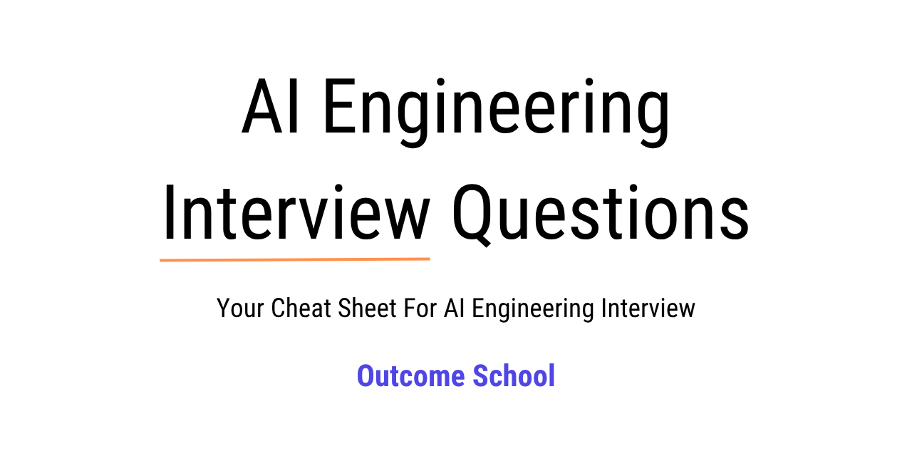

<p align="center">
    
</p>

> **한국어 번역본 안내**  
> 이 저장소는 [amitshekhariitbhu/ai-engineering-interview-questions](https://github.com/amitshekhariitbhu/ai-engineering-interview-questions)를 한국어로 번역하고, 한 파일에 있던 질문을 챕터별 파일([chapters/](chapters/))로 나눠 재구성한 것입니다.  
> 원저작물의 저작권은 Outcome School에 있으며, 원본과 같은 Apache License 2.0([LICENSE](LICENSE))으로 배포합니다.  
> 원본에는 답변이 원작자의 영어 블로그·영상 링크로만 달려 있습니다. 이 번역본에서는 각 질문 아래에 **한국어 답변을 새로 작성해 접어 두었습니다**(질문을 클릭하면 펼쳐짐). 원작자의 영문 자료는 각 답변 끝 "더 읽어보기"에 그대로 남겨 두었습니다.  
> 한국어 답변은 AI(Claude)가 작성한 학습용 설명이며, 원작자의 글을 번역한 것이 아닙니다. 틀린 내용이 있을 수 있으니 중요한 내용은 원문 자료와 공식 문서로 확인하세요.  
> 영어 원문은 이 저장소의 첫 번째 커밋에서 볼 수 있습니다.

# AI 엔지니어링 면접 질문과 답변

> AI 엔지니어링 면접 질문과 답변 - AI 엔지니어링 면접을 위한 치트 시트
>
> 이 면접 질문과 답변은 다음과 같은 직무에 도움이 됩니다:
>
> - AI 엔지니어 (AI Engineer)
> - 생성형 AI 엔지니어 (Gen AI Engineer)
> - LLM 엔지니어 (LLM Engineer)
> - 에이전틱 AI 엔지니어 (Agentic AI Engineer)
> - AI 에이전트 엔지니어 (AI Agent Engineer)
> - 포워드 디플로이드 엔지니어 (Forward Deployed Engineer)
> - AI 솔루션 아키텍트 (AI Solutions Architect)
> - AI 플랫폼 엔지니어 (AI Platform Engineer)
> - 응용 AI 엔지니어 (Applied AI Engineer)
> - MLOps 엔지니어 (MLOps Engineer)
> - LLMOps 엔지니어 (LLMOps Engineer)

## 목차

| # | 챕터 | 질문 수 |
|---|---|---|
| 1 | [꼭 알아야 할 개념 (Must Know)](chapters/01_must_know.md) | 6 |
| 2 | [LLM 기초 (LLM Fundamentals)](chapters/02_llm_fundamentals.md) | 81 |
| 3 | [프롬프트 엔지니어링 (Prompt Engineering)](chapters/03_prompt_engineering.md) | 30 |
| 4 | [검색 증강 생성 (RAG)](chapters/04_rag.md) | 42 |
| 5 | [AI 에이전트와 에이전틱 시스템 (AI Agents and Agentic Systems)](chapters/05_ai_agents.md) | 54 |
| 6 | [파인튜닝과 모델 적응 (Fine-Tuning and Model Adaptation)](chapters/06_fine_tuning.md) | 32 |
| 7 | [벡터 데이터베이스와 임베딩 (Vector Databases and Embeddings)](chapters/07_vector_databases_and_embeddings.md) | 26 |
| 8 | [AI 시스템 설계 (AI System Design)](chapters/08_ai_system_design.md) | 49 |
| 9 | [LLMOps와 프로덕션 AI (LLMOps and Production AI)](chapters/09_llmops.md) | 53 |
| 10 | [평가와 테스트 (Evaluation and Testing)](chapters/10_evaluation_and_testing.md) | 36 |
| 11 | [AI 안전성, 윤리, 책임 있는 AI (AI Safety, Ethics, and Responsible AI)](chapters/11_ai_safety_and_ethics.md) | 45 |
| 12 | [멀티모달 AI (Multimodal AI)](chapters/12_multimodal_ai.md) | 36 |
| 13 | [AI 인프라와 확장성 (AI Infrastructure and Scalability)](chapters/13_ai_infrastructure.md) | 35 |
| 14 | [코딩과 실전 구현 (Coding and Practical Implementation)](chapters/14_coding.md) | 32 |
| 15 | [행동 및 상황 기반 질문 (Behavioral and Scenario-Based Questions)](chapters/15_behavioral_and_scenario.md) | 22 |

### 원작자: [Outcome School](https://outcomeschool.com) 설립자 Amit Shekhar가 작성하고 관리합니다

### Amit Shekhar 팔로우하기

- [X/Twitter](https://twitter.com/amitiitbhu)
- [LinkedIn](https://www.linkedin.com/in/amit-shekhar-iitbhu)
- [GitHub](https://github.com/amitshekhariitbhu)

### Outcome School 팔로우하기

- [YouTube](https://youtube.com/@OutcomeSchool)
- [X/Twitter](https://x.com/outcome_school)
- [LinkedIn](https://www.linkedin.com/company/outcomeschool)
- [GitHub](https://github.com/OutcomeSchool)

## 원작자의 Outcome School 강의

- [AI and Machine Learning](https://outcomeschool.com/program/ai-and-machine-learning)

---

> **참고: 원본 저장소에는 새로운 질문과 답변이 계속 추가됩니다.** 이 번역본은 원본 커밋 `0635af0`(2026-10-26) 기준입니다.

---

### 라이선스

```
   Copyright (C) 2026 Outcome School

   Licensed under the Apache License, Version 2.0 (the "License");
   you may not use this file except in compliance with the License.
   You may obtain a copy of the License at

       http://www.apache.org/licenses/LICENSE-2.0

   Unless required by applicable law or agreed to in writing, software
   distributed under the License is distributed on an "AS IS" BASIS,
   WITHOUT WARRANTIES OR CONDITIONS OF ANY KIND, either express or implied.
   See the License for the specific language governing permissions and
   limitations under the License.
```

한국어 번역과 챕터별 재구성도 같은 Apache License 2.0으로 배포합니다.
